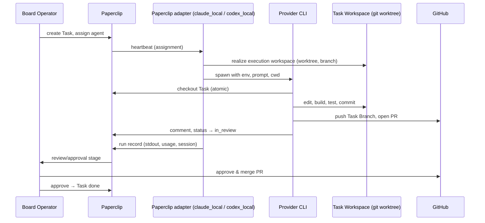
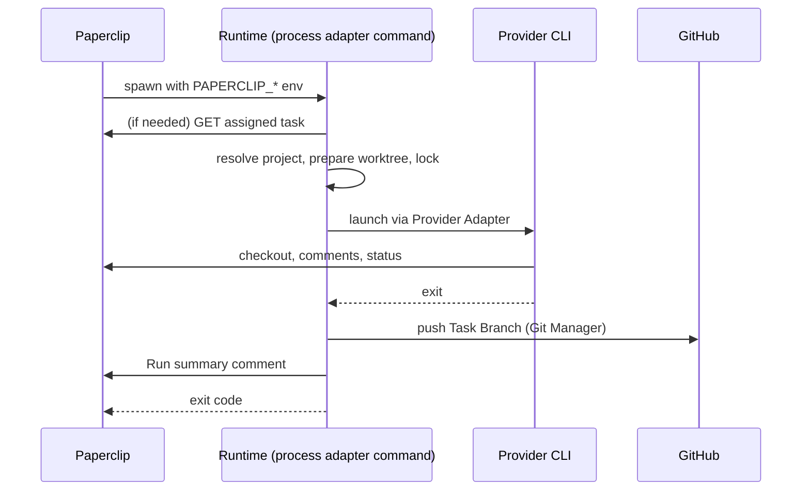

# Data Flow

This document describes **what information moves between systems, in which direction, and who owns it**. Interfaces (endpoints, flags) are owned by [../integrations/](../integrations/).

## 1. Data ownership

| Data | System of record | Copies / caches |
|---|---|---|
| Studio definition (company, roles, rules, workflows) | Framework Repository (Git) | Imported into Paperclip agents/instructions |
| Project registry | Framework Repository | Paperclip project records (name, workspace) |
| Dependency registry | Framework Repository | — |
| Agents (instances, status, budgets) | Paperclip | Runtime local mapping (agent ID → role) |
| Tasks, comments, status | Paperclip | Run records reference Task ID |
| Approvals and execution-policy decisions | Paperclip | Mirrored on GitHub PR reviews for merges |
| Run records (Paperclip side) | Paperclip | — |
| Run records (Runtime side, `PLANNED`) | Runtime Data | Summary posted to Paperclip |
| Source code and history | Game Repository on GitHub | Primary Checkout, Task Workspaces |
| Credentials | Provider homes (`~/.claude`, `~/.codex`), Paperclip secrets, OS keyring | Never in Git |

## 2. Flows

### F1. Studio setup (Game Studio → Paperclip)
1. Board Operator creates the Paperclip company and agents from `company/` and `agents/` (manually in v1; via `company import` if OQ-007 resolves positively).
2. Board Operator creates one Paperclip project per Game Project, with a project workspace pointing at the Game Repository (`repoUrl`, `repoRef`, optional `cwd`).
3. Board Operator writes the resulting Paperclip project ID into `projects/project-registry.yaml` (`paperclip.projectId`).

Direction: Git → Paperclip (configuration), Paperclip → Git (IDs). Trigger: [project-initialization.md](../../workflows/project-initialization.md).

### F2. Task creation and assignment (inside Paperclip)
Board Operator or a manager agent creates a Task (title, description, project, assignee, optional execution policy). Paperclip stores it and triggers a heartbeat on assignment. No Game Studio component is involved. Trigger: [task-delegation.md](../../workflows/task-delegation.md).

### F3. Execution request (Paperclip → executor)
Paperclip invokes the agent's adapter. Data passed (`VERIFIED`, Paperclip docs): agent ID, company ID, run ID, task ID (when the wake has one), wake reason, API URL, short-lived run JWT (`PAPERCLIP_API_KEY`), adapter config (cwd, model, prompt template, env, timeout). For local CLI adapters Paperclip also resolves the execution workspace (path, branch).

### F4. Context assembly (Game Studio → Provider)
The executor gives the Provider: role instructions (`agents/<agent-id>/AGENTS.md`), studio rules, Task content. The Provider reads the Game Repository's `AGENTS.md`/`CLAUDE.md` from cwd. In Stage 1, role instructions reach Claude Code/Codex through Paperclip adapter settings (`promptTemplate`, `instructionsFilePath` for Codex); the exact mechanism per adapter is OQ-023.

### F5. Work (Provider ↔ Task Workspace, Provider → Tools)
The Provider reads and edits files in the Task Workspace, runs build/test commands, calls MCP tools (e.g. Playwright for browser tests) and skills, and commits on the Task Branch. Data stays on the machine except for model API traffic to the Provider vendor and tool traffic.

### F6. Progress and status (Provider/agent → Paperclip)
During the heartbeat the agent calls Paperclip's REST API with the run JWT: checkout the Task, post comments, update status, create sub-tasks, request confirmation or approval. Mutating calls carry `X-Paperclip-Run-Id`.

### F7. Result capture (executor → Paperclip)
The adapter captures stdout, usage and cost, and session state into Paperclip's run record. In Stage 2 the Runtime additionally posts a Run summary comment (§8 of [runtime-architecture.md](runtime-architecture.md)).

### F8. Code delivery (Task Workspace → GitHub)
Task Branch pushed to the Game Repository; pull request opened, linked to the Task in a comment. Credentials: project-scoped GitHub token ([security-architecture.md §2](security-architecture.md#2-credential-handling)).

### F9. Review and approval (Paperclip ↔ GitHub ↔ Board Operator)
Review stage (agent, e.g. `qa`) and approval stage (Board Operator) run in Paperclip's execution policy. The Board Operator approves and merges the PR in GitHub. The Task moves to `done`. Trigger: [code-review-and-merge.md](../../workflows/code-review-and-merge.md).

### F10. Dependencies (external → machine)
Tools are installed on the machine from their official sources after approval. Only the registry entry enters Git.

## 3. Sequence: one Task, Stage 1 (Paperclip-native)

## 4. Sequence: one Task, Stage 2 (Runtime behind `process` adapter, `PLANNED`)

## Related documents
- [overview.md](overview.md) · [runtime-architecture.md](runtime-architecture.md) · [../integrations/paperclip-integration.md](../integrations/paperclip-integration.md)
