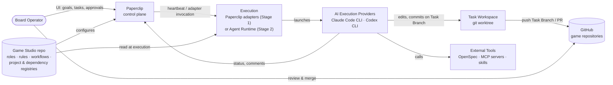

# Architecture Overview

**Status:** Architecture v1.0. Component status labels follow [../conventions.md](../conventions.md).

## 1. Vision

Game Studio lets one Board Operator run a studio of AI agents that builds several games at once. The operator works through **Paperclip** (dashboard, tasks, approvals) and does not need to open a game's source-code workspace by hand. Agents receive Tasks, work in the correct Game Repository using Claude Code or Codex, and report results back to Paperclip. Humans approve what gets merged and released.

## 2. System context



The "Execution" box is deliberately abstract. Who fills it is decided by [ADR-011](../decisions/ADR-011-execution-path-selection.md) (accepted): Paperclip's own adapters first, then the Game Studio Runtime for gaps.

## 3. Major components

| Component | One-line responsibility | Owner | Status |
|---|---|---|---|
| Paperclip | Operate the company: agents, projects, tasks, approvals, heartbeats | Paperclip project | External; not installed (OQ-024) |
| Game Studio Core | Define the studio: company, roles, rules, workflows | This repo | Documented (files exist); nothing automated |
| Agent Definitions | One role definition per agent | This repo, `knowledge/company/agents/` | Documented (8 roles) |
| Workflow definitions | Documented processes with gates | This repo, `knowledge/company/workflows/` | Documented (12 workflows) |
| Project Registry | Which games exist and where their repos are | This repo, `knowledge/projects/` | Empty registry; schema `PROPOSED` |
| Dependency Registry | Which external tools the studio uses | This repo, `dependencies/` | Candidate entries |
| Integrations | Contracts for Paperclip, Claude Code, Codex, OpenSpec | This repo, `docs/integrations/` | Documented; no adapter code |
| Agent Runtime | Execute Tasks locally (dispatcher, launcher, workspace, git, reporter) | This repo, `runtime/` | `PLANNED` |
| AI Execution Providers | Perform the coding work | Anthropic / OpenAI | Claude Code installed; Codex not on PATH (OQ-009) |
| GitHub | Host repositories, pull requests, branch protection | GitHub | In use |

Full contracts: [system-components.md](system-components.md).

## 4. Responsibility boundaries

```text
Paperclip decides WHO works on WHAT and WHEN, and records approvals.
Game Studio defines WHAT the roles, rules, and processes ARE.
Execution (Paperclip adapter or Runtime) does the work WHERE (which repo, which worktree) and HOW (which CLI).
Providers do the actual reasoning and editing.
GitHub stores the result; humans merge it.
```

## 5. Primary execution flow (one Task)

1. The Board Operator (or a manager agent such as `project-manager`) creates a Task in Paperclip, inside the Paperclip project mapped to a Game Project, and assigns an Agent Instance. See [task-delegation.md](../../knowledge/company/workflows/task-delegation.md).
2. Paperclip wakes the agent with a heartbeat (trigger: assignment).
3. The executor resolves the project's repository and prepares a Task Workspace (Git worktree) on a Task Branch.
4. The executor launches the Provider CLI in the Task Workspace with the role instructions, studio rules, and Task context.
5. The agent checks out the Task in Paperclip (atomic, single owner), does the work, commits on the Task Branch, and posts progress comments.
6. On completion the agent pushes the Task Branch and opens a pull request (if permitted), then moves the Task to `in_review`.
7. Review stage: `qa` or another agent reviews. Approval stage: the Board Operator approves.
8. The Board Operator merges the pull request. The Task moves to `done`.

Detail: [development-cycle.md](../../knowledge/company/workflows/development-cycle.md), [runtime-architecture.md](runtime-architecture.md), [data-flow.md](data-flow.md).

## 6. External system boundaries

| Boundary | Game Studio may | Game Studio must not |
|---|---|---|
| Paperclip | Use documented REST API, CLI, adapters, company import/export | Modify Paperclip source; rely on undocumented endpoints; duplicate its features without a recorded gap |
| Claude Code / Codex | Invoke documented CLI flags; read their output | Store their credentials in Git; bypass their permission systems without a recorded decision |
| GitHub | Clone, fetch, push Task Branches, open PRs (with credentials scoped per security policy) | Push to Default Branch; force-push; delete repositories |
| External tools | Install per official instructions after approval; reference in registry | Vendor or copy source into this repo |

## 7. Key quality attributes

| Attribute | How it is achieved |
|---|---|
| Multi-project isolation | Independent repos (ADR-005); per-task worktrees (ADR-006); project-scoped Paperclip projects |
| Safety | Approval before merge (ADR-009); explicit permission profiles ([security-architecture.md](security-architecture.md)) |
| Replaceability | Provider abstraction (ADR-008); dependency registry (ADR-007) |
| Recoverability | Task-based runs (ADR-004); persisted state outside processes |
| AI readability | Explicit contracts, glossary, status labels |

## Related documents
- [system-components.md](system-components.md) · [runtime-architecture.md](runtime-architecture.md) · [data-flow.md](data-flow.md) · [security-architecture.md](security-architecture.md)
- [../decisions/README.md](../decisions/README.md) · [open-questions.md](../roadmap/open-questions.md)
