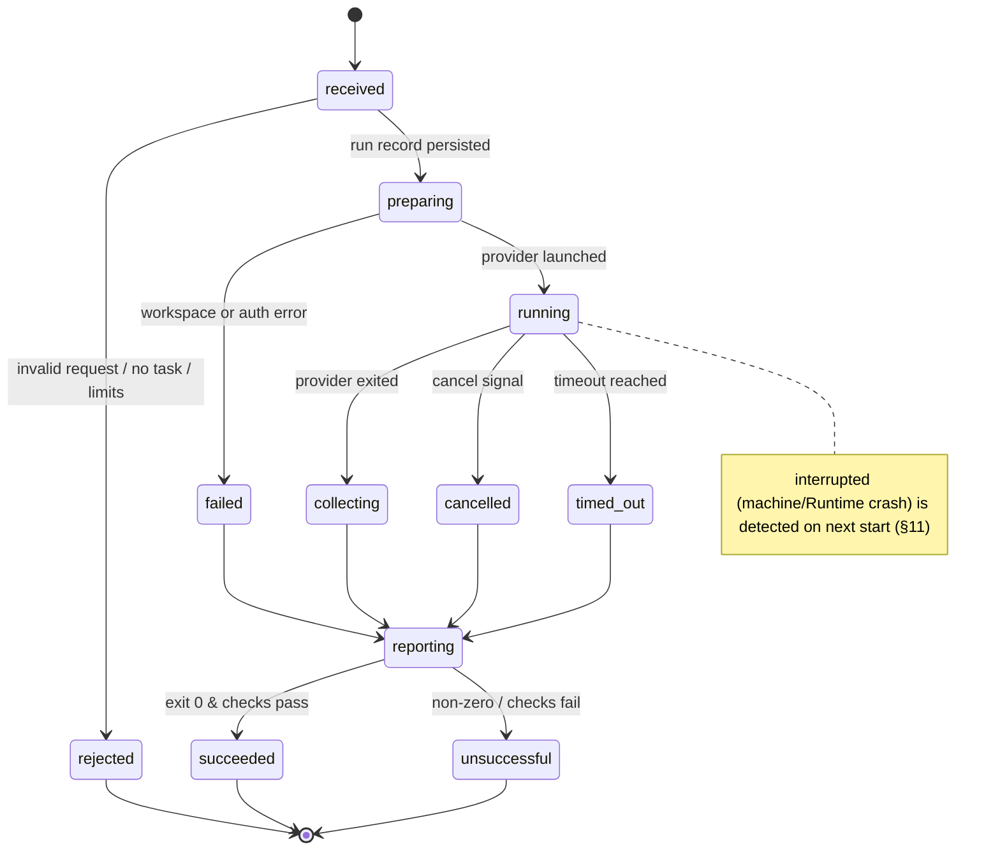

# Runtime Architecture

**Status:** `PLANNED`. No Runtime code exists. Under [ADR-011](../decisions/ADR-011-execution-path-selection.md), Stage 1 uses Paperclip's built-in adapters and execution workspaces, and the Runtime described here is built in Stage 2 **only for gaps found in Stage 1**. This document is the target design for that Runtime. Every sub-component below must be re-checked against the gap analysis before implementation.

## 1. Scope

The Runtime executes one Run (one Task, one Provider process) on the studio's Windows machine (ADR-013, ADR-004). It owns: run request validation, project resolution, Task Workspace preparation, Provider launch and supervision, Git safety, result collection, reporting to Paperclip, and recovery.

It does **not** own: task creation, assignment, scheduling, approvals, budgets, or the org chart. Paperclip owns those.

## 2. Invocation model and lifecycle

**Proposed entry point (ADR-011 Stage 2):** Paperclip's `process` adapter. A Paperclip Agent Instance is configured with `adapterType: "process"` and a command such as `game-studio-runtime run` (`PLANNED`; the command does not exist). Paperclip runs the command on each heartbeat and injects `PAPERCLIP_*` environment variables. The command's exit code tells Paperclip whether the run succeeded (`VERIFIED` behaviour of the `process` adapter, Paperclip docs `adapters/process.md`).

Consequences of this model:

- The Runtime is **not a daemon**. Each heartbeat starts one Runtime process, which starts one Provider process, and both exit when the Run ends.
- The Runtime's own lifecycle is the Run lifecycle (§3).
- Maintenance actions (doctor, recovery sweep, workspace cleanup) are separate `PLANNED` subcommands run by the operator or on each invocation.

Open: whether a `process` agent receives the Task ID and the resolved execution workspace (OQ-003). If it does not, the Runtime must query the Paperclip API (`GET /api/agents/me`, assigned issues) to discover its Task. Both are documented API capabilities; the env-var delivery is the unverified part.

## 3. Task execution lifecycle



| State | Entered when | Persisted fields |
|---|---|---|
| `received` | Runtime process starts with a Run request | run ID, Paperclip run ID, agent ID, timestamps |
| `preparing` | Request validated | project ID, task key, provider ID |
| `running` | Provider process spawned | PID, process group ID, workspace path, branch, start commit |
| `collecting` | Provider exited | exit code, signal, end commit, diff stats |
| `reporting` | Results assembled | report payload, report attempts |
| terminal | Report delivered or queued | final status, duration |

Task status in Paperclip (backlog → todo → in_progress → in_review → done, plus blocked and cancelled) is separate from Run state. The agent itself moves the Task through Paperclip statuses; the Runtime only reports.

## 4. Dispatcher

Inputs: Paperclip environment (`PAPERCLIP_AGENT_ID`, `PAPERCLIP_COMPANY_ID`, `PAPERCLIP_RUN_ID`, `PAPERCLIP_TASK_ID`, `PAPERCLIP_WAKE_REASON`, `PAPERCLIP_API_URL`, `PAPERCLIP_API_KEY`; names `VERIFIED` in Paperclip's agent-developer docs), local Runtime config, project registry, agent definitions.

Steps:

1. Validate the environment. Missing `PAPERCLIP_API_KEY` or API URL → `rejected`, exit non-zero.
2. Identify the Agent Role. Map the Paperclip agent ID → Agent ID via local config (`agents.<paperclip-agent-id>.role`).
3. Identify the Task. Use `PAPERCLIP_TASK_ID` if present. Otherwise query the Paperclip API for assigned work. No Task → exit 0 with "no work" (a normal heartbeat outcome).
4. Resolve the Game Project. Task → Paperclip project → `paperclip.projectId` in [projects/project-registry.yaml](../../projects/project-registry.yaml) → Project ID. No match → `rejected`, with a comment on the Task explaining why.
5. Check limits: global max concurrent Runs, per-project max, and the workspace lock (§12).
6. Persist the run record, then hand off to the Workspace Manager.

## 5. Agent Launcher and Provider abstraction

### 5.1 Provider Adapter interface (`PROPOSED`, TypeScript notation)

```ts
interface ProviderAdapter {
  id: "claude_local" | "codex_local" | string;   // matches Paperclip adapter type keys
  detect(): Promise<{ installed: boolean; version?: string; path?: string }>;
  checkAuth(): Promise<{ ok: boolean; mode?: "subscription" | "api_key"; hint?: string }>;
  buildInvocation(req: RunRequest): {
    argv: string[];               // no secrets in argv
    env: Record<string, string>;  // secrets only via env or files
    cwd: string;                  // Task Workspace
    stdin?: string;               // prompt delivery
  };
  parseEvent(line: string): RunEvent | null;       // streaming output → normalized events
  classifyExit(code: number | null, signal: string | null, tail: string): ExitClass;
  capabilities: { structuredOutput: boolean; sessionResume: boolean; sandbox: boolean; mcp: boolean };
}
type ExitClass = "success" | "task_failure" | "auth_error" | "quota_or_rate_limit"
               | "timeout" | "cancelled" | "provider_crash" | "invalid_invocation";
```

`RunRequest` carries: run ID, Task (ID, key, title, description), Agent Role instructions (body of `agents/<agent-id>/AGENTS.md`), studio rules, project context (game repo `AGENTS.md` is read by the Provider itself from cwd), permission profile, timeout, model override.

### 5.2 Provider-specific invocation

Verified CLI flags and the recommended invocation for each Provider are owned by the integration documents:
- Claude Code: [claude-code-integration.md](../integrations/claude-code-integration.md)
- Codex: [codex-integration.md](../integrations/codex-integration.md)

### 5.3 Prompt assembly

Order: (1) studio rules summary, (2) Agent Role instructions, (3) Task content, (4) Run constraints (branch, allowed actions, how to report). The game repository's own `AGENTS.md`/`CLAUDE.md` is discovered by the Provider from cwd and is not duplicated in the prompt.

## 6. Workspace Manager

| Concern | Rule |
|---|---|
| Primary Checkout | `~/game-studio-workspace/repos/<project-id>/` (configurable). Created by `git clone` on first use. `git fetch` before creating a worktree. Never used for task work. |
| Task Workspace path | `~/game-studio-workspace/worktrees/<project-id>/<task-key>/` |
| Task Branch name (`PROPOSED`) | `agent/<agent-id>/<task-key>`, e.g. `agent/gameplay-programmer/NODE-42`. Lowercase; characters outside `[a-z0-9._/-]` replaced with `-`. |
| Base | `origin/<default-branch>` at creation time, unless the Task specifies a base branch. |
| Reuse | A later Run of the same Task reuses its Task Workspace and branch (continuation after review feedback). |
| Lock | One lock file per Task Workspace in Runtime Data. A second Run for the same workspace is rejected while the lock is held by a live PID. |
| Cleanup | Only after the Task is `done` or `cancelled` **and** the branch is merged or explicitly abandoned. Uses `git worktree remove` (never `--force` on a dirty tree). Dirty trees are preserved and reported. |
| Paperclip-owned mode | When Paperclip's execution workspace provides the cwd (Stage 1, or Stage 2 if OQ-003 resolves that way), the Workspace Manager MUST NOT create a second worktree; it validates the given cwd instead. |

## 7. Git Manager

Allowed: `clone`, `fetch`, `worktree add/list/remove`, `checkout -b` on Task Branches, `status`, `diff`, `log`, `push origin <task-branch>` (no force), `gh pr create` (`PLANNED`).

Forbidden (enforced by the Runtime and by GitHub branch protection): pushing to the Default Branch, `push --force` / `--force-with-lease`, `reset --hard` on shared branches, `branch -D` of branches not created by the Runtime, `merge` into the Default Branch, rebasing published branches, deleting tags or repositories.

Recorded per Run: start commit, end commit, branch, remote URL, PR URL. Stored in the run record and posted to the Task.

Pre-push checks (`PLANNED`): no files larger than the configured limit, no paths matching secret patterns (`.env`, `*.pem`, `id_*`), commits authored with the configured agent identity.

## 8. Result Reporter

- Posts one Run summary comment on the Task: outcome, exit class, branch, commit range, PR link, log location (local path is *not* posted; only the run ID).
- Sends `X-Paperclip-Run-Id` on mutating requests (`VERIFIED` requirement in Paperclip API docs).
- Does not set Task status to `done`; the agent requests review/approval via the Task's execution policy.
- If Paperclip is unreachable: write the report to `~/.local/state/game-studio/outbox/` and retry on the next invocation (exponential backoff, max age configurable).

## 9. Process management

| Concern | Rule |
|---|---|
| Spawn | Provider started in its own process group; cwd = Task Workspace; env built from an allowlist plus Provider auth variables. |
| Output | stdout/stderr streamed to `runs/<run-id>/stdout.log` / `stderr.log` and parsed line by line by the Provider Adapter. |
| Timeout | Per-agent `timeoutSec` (default 3600, `PROPOSED`). On timeout: SIGTERM to the process group, wait `graceSec` (default 30), then SIGKILL. |
| Cancellation | SIGTERM/SIGINT received by the Runtime is forwarded to the Provider process group with the same grace logic. |
| Resource limits | `PROPOSED`: optional Windows Job Object limits (memory/CPU) on the Provider process tree; mechanism not chosen. `UNVERIFIED` that it is needed (OQ-015). |
| Exit | Runtime exit code: 0 = success or "no work"; non-zero = failure. This is what Paperclip's `process` adapter records. |

## 10. Error handling

| Exit class | Example | Runtime action | Task effect |
|---|---|---|---|
| `invalid_invocation` | Unknown agent mapping, project not registered | Reject; comment with fix instructions | Task stays; Board notified |
| `auth_error` | Provider not logged in; GitHub token invalid | Fail fast; no retry | Comment; Task → `blocked` by agent/operator |
| `quota_or_rate_limit` | Provider usage limit | No immediate retry; report reset time if known | Comment; retry on a later heartbeat |
| `timeout` | Exceeded `timeoutSec` | Kill, preserve workspace | Comment; next Run continues |
| `provider_crash` | CLI crashed | Preserve logs; one automatic retry per Task per hour (`PROPOSED`) | Comment |
| `task_failure` | Agent reported it could not complete | Preserve workspace | Agent's own comment; escalation per role |
| Git error | Push rejected, conflict | Never force; report | Comment; human or agent resolves |

Full procedure: [task-failure-handling.md](../../workflows/task-failure-handling.md).

## 11. Restart and recovery

On every start, before dispatching, the Runtime runs a recovery sweep over `~/.local/state/game-studio/runs/`:

1. Find run records in non-terminal states.
2. For each, check whether the recorded PID / process group is alive and belongs to the same boot (compare `/proc/sys/kernel/random/boot_id` stored at launch).
3. Dead → mark `interrupted`, release the workspace lock, keep the workspace, queue a report ("Run interrupted; work preserved on branch X").
4. Alive (another Runtime instance) → leave untouched.
5. Flush the outbox.

Paperclip-side recovery of heartbeat runs is Paperclip's responsibility.

## 12. Concurrent execution

| Limit | Default (`PROPOSED`) | Scope |
|---|---|---|
| Max concurrent Runs | 2 | Machine |
| Max concurrent Runs per project | 2 | Project |
| Runs per Task Workspace | 1 (hard) | Workspace |
| Runs per Task | 1 (enforced by Paperclip atomic checkout, `VERIFIED`) | Task |

Conflict avoidance between parallel Tasks is a planning concern of `project-manager` ([parallel-tasks.md](../../workflows/parallel-tasks.md)). The Runtime guarantees only isolation, not semantic non-conflict.

## 13. Implementation notes (`PROPOSED`)

- Language: TypeScript on Node.js, matching Paperclip and its adapter ecosystem (OQ-013).
- State store: JSON files per run plus an index, or SQLite (OQ-014).
- Config: `~/.config/game-studio/runtime.yaml`, validated against a schema in `schemas/` ([configuration.md](../operations/configuration.md)).

## Related documents
- [system-components.md](system-components.md) · [data-flow.md](data-flow.md) · [security-architecture.md](security-architecture.md)
- [../decisions/ADR-003-native-ubuntu-agent-runtime.md](../decisions/ADR-003-native-ubuntu-agent-runtime.md) · [../decisions/ADR-004-task-based-agent-execution.md](../decisions/ADR-004-task-based-agent-execution.md) · [../decisions/ADR-006-git-worktree-for-concurrent-tasks.md](../decisions/ADR-006-git-worktree-for-concurrent-tasks.md) · [../decisions/ADR-011-execution-path-selection.md](../decisions/ADR-011-execution-path-selection.md)
- [../operations/runtime-management.md](../operations/runtime-management.md)
