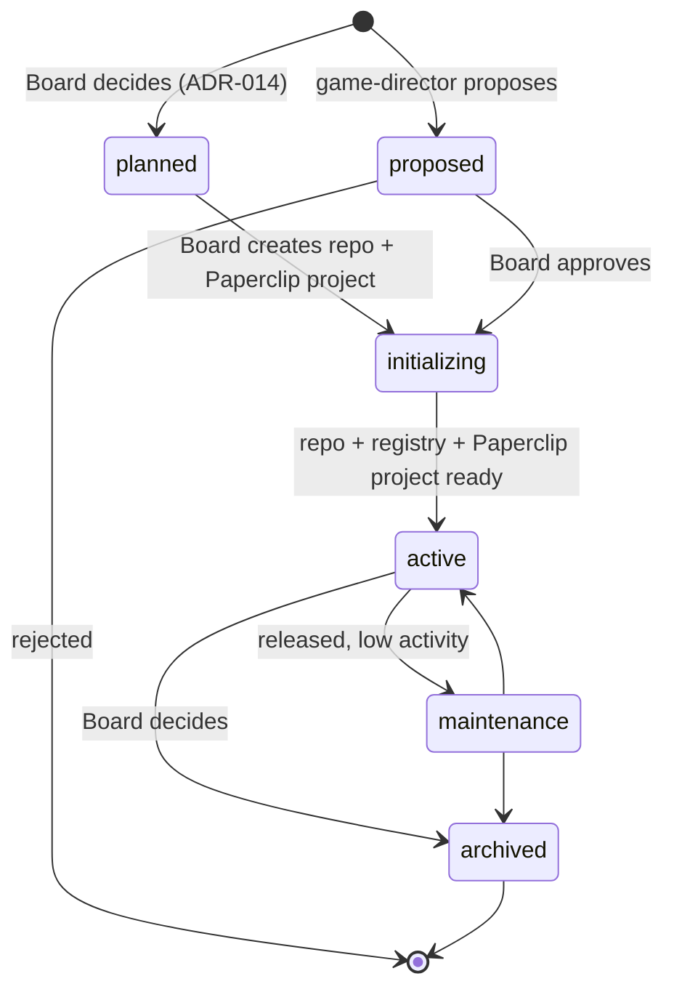

# Project System

**Contract owner for:** registration, configuration, lifecycle, isolation, and repository resolution of Game Projects and Platform Projects.

**Project types** (`APPROVED`, [ADR-014](../decisions/ADR-014-platform-project-type.md)): `game` (default) or `platform`. A platform project, for example the studio website, hosts games and owns shared services. Both types follow this contract. Platform projects also follow [security-architecture.md §10](../architecture/security-architecture.md#10-production-environments-platform-projects) and implement the [game platform contract](game-platform-contract.md).

## 1. Registration

A Game Project or Platform Project exists when **all three** are true (a `planned` project has none of them yet):
1. A Game Repository exists on GitHub (`datpham02/<project-id>`).
2. An entry exists in [projects/project-registry.yaml](../../projects/project-registry.yaml) that validates against [projects/project-config.schema.yaml](../../projects/project-config.schema.yaml).
3. A Paperclip project exists and its ID is recorded in the entry.

Workflows: [project-initialization.md](../../workflows/project-initialization.md) (new game) and [register-existing-repository.md](../../workflows/register-existing-repository.md) (existing repository).

## 2. Project configuration

Fields (schema status `PROPOSED`):

| Field | Required | Meaning |
|---|---|---|
| `id` | Yes | Project ID, kebab-case, equals repository name |
| `name` | Yes | Display name |
| `type` | No | `game` (default) or `platform` (ADR-014) |
| `status` | Yes | Lifecycle state (§3) |
| `repository.url` | Yes, except while `planned` | HTTPS clone URL |
| `repository.defaultBranch` | Yes | Usually `main` |
| `engine.name` / `engine.version` | No | e.g. `godot` / `4.4`; drives skill selection |
| `paperclip.projectId` | Yes once active | Paperclip project ID |
| `agents` | No | Agent IDs enabled for this project (default: all) |
| `dependencies` | No | Dependency IDs this project uses (must exist in the dependency registry) |
| `workflows` | No | Workflow parameter overrides (§7 of [workflow-system.md](workflow-system.md)) |
| `specs.tool` | No | `openspec` or `none` |
| `frameworkVersion` | Yes | Framework version the project was set up with |

**Not** in the registry (local, ADR-010): local checkout path, worktree root, tokens. These live in `~/.config/game-studio/runtime.yaml` keyed by Project ID ([configuration.md](../operations/configuration.md)).

## 3. Lifecycle

| State | Agents may | Agents may not |
|---|---|---|
| `planned` | Discuss and draft the plan in a Paperclip issue | Create repositories, Paperclip projects or external accounts; commit project plans to the framework repository |
| `proposed` | Discuss, write concept docs in Paperclip | Touch any repository |
| `initializing` | Seed repository files on a Task Branch | Implement features |
| `active` | All work per role | — |
| `maintenance` | Bug fixes, patches | New features without Board approval |
| `archived` | Nothing | Any write |

**Project documents live in the project repository** (Board decision, 2026-11-04). ADR-014 §2 allows plan documents in the framework while a project is `planned`, but the studio does not use that allowance. The Board creates the project repository first, and plans, requirements and setup checklists are written there from the start. Until the repository exists, drafts stay in a Paperclip issue. The one exception is Soucean Game: its plan files were committed to `docs/plans/` before this decision. The seeding Task (GAM-20) moved them into its repository, and they were then deleted here.

## 4. Project-specific context

Context that is specific to one game lives **in the Game Repository**, not in the framework:
- `AGENTS.md` / `CLAUDE.md`: engine, build and test commands, code conventions, directory map;
- design docs and specs (OpenSpec `openspec/` if used);
- engine configuration.

The framework provides only generic role instructions. Agents read the game's `AGENTS.md` at the start of each Run.

## 5. Agent assignment

- By default all roles serve all projects. `agents` in the registry entry restricts which roles may receive Tasks for the project.
- `project-manager` assigns Tasks only to Agent Instances whose role is enabled for the Task's project.

## 6. Dependency selection

- A project lists the Dependencies it uses. Engine-specific skill packs are selected by `engine.name`.
- A Dependency MUST be in the dependency registry and approved for installation before a project lists it.

## 7. Repository resolution

Given a Task:
1. Task → Paperclip project ID (from the issue).
2. Paperclip project ID → registry entry (`paperclip.projectId`).
3. Registry entry → `repository.url`, `defaultBranch`.
4. Local config → Primary Checkout path (Stage 2), or Paperclip's project workspace (Stage 1, where Paperclip resolves it from the workspace `repoUrl`/`cwd`).

A Task whose project is not in the registry MUST NOT be executed.

## 8. Isolation

- One repository per game (ADR-005); one Paperclip project per game.
- A Run's cwd is a Task Workspace of exactly one Game Repository.
- Agents MUST NOT read or write other Game Repositories without an explicit Task instruction approved by the Board Operator.
- GitHub tokens SHOULD be scoped to the repositories an Agent Instance serves.

## Related documents
- [../../projects/project-registry.yaml](../../projects/project-registry.yaml) · [../../projects/project-config.schema.yaml](../../projects/project-config.schema.yaml) · [../architecture/repository-architecture.md](../architecture/repository-architecture.md)
